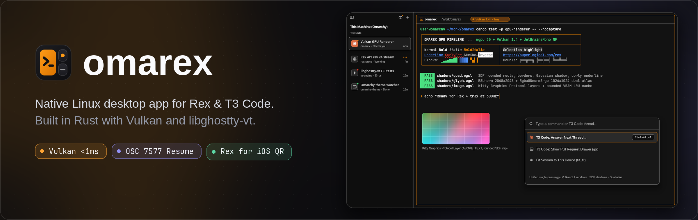
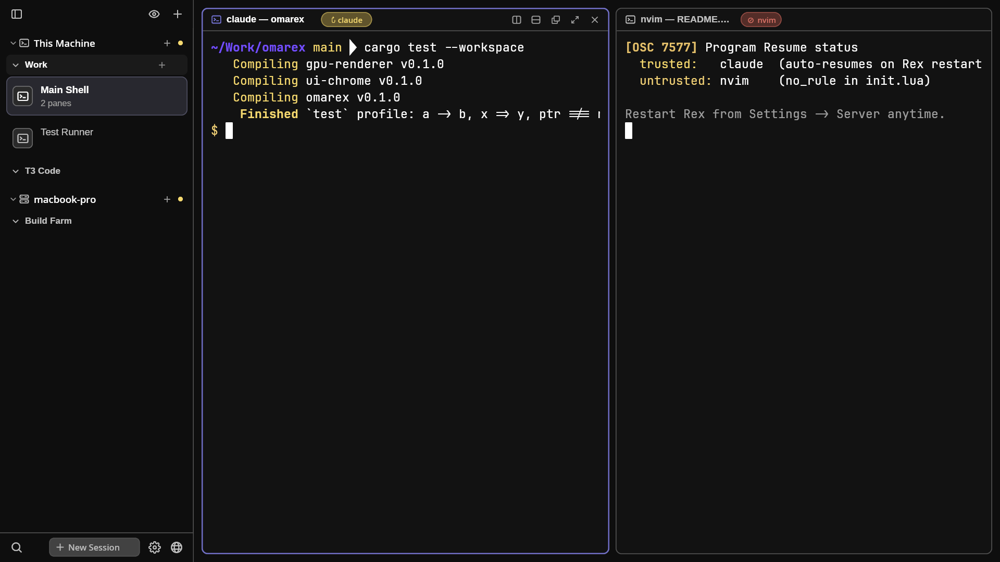
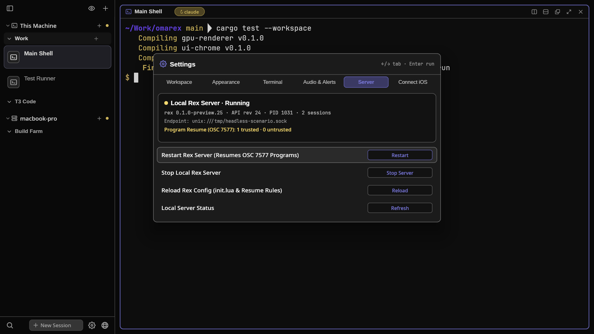
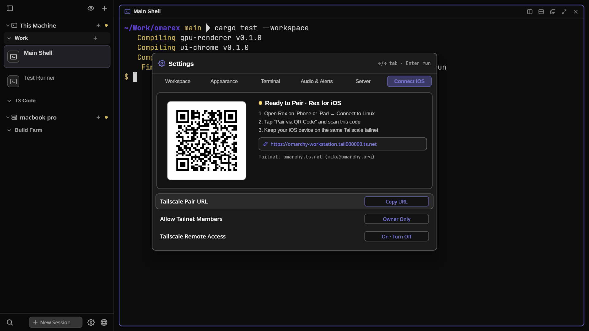

<p align="center">
  
</p>

<h1 align="center">omarex</h1>

<p align="center">
  <a href="#quick-install">Quick Install</a> ·
  <a href="#screenshots">Screenshots</a> ·
  <a href="#getting-started">Getting Started</a> ·
  <a href="#performance">Performance</a> ·
  <a href="#documentation">Docs</a>
</p>

<p align="center">
  <a href="LICENSE"></a>
  
  <a href="https://rex.superlogical.com/"></a>
  <a href="https://omarchy.org"></a>
</p>

**The native Linux desktop app for [Superlogical Rex](https://rex.superlogical.com/) and [T3 Code](https://github.com/macnason/tr3x) on [Omarchy](https://omarchy.org).** Built in Rust with `wgpu` Vulkan rendering and Ghostty's `libghostty-vt`, `omarex` brings sub-millisecond frames, live theme sync, and a fast workspace built for running coding agents side by side on Arch Linux and Hyprland.

`omarex` is an experimental, MIT-licensed community client built in the open. Everything connects directly to your local Rex daemon, remote Tailscale and SSH servers, and Rex for iOS with zero Electron overhead and zero cloud lock-in.

<table>
<tr><td><b>Resume programs across restarts</b></td><td>Full support for Rex's <a href="https://www.superlogical.com/rex/docs/build/program-resume">OSC 7577 Program Resume</a>. See trusted (<code>↻</code>) and untrusted (<code>⊘</code>) resume badges right in each pane header, restart the Rex server from <b>Settings → Server</b>, and jump straight back into your active session without losing your place.</td></tr>
<tr><td><b>Pair Rex for iOS in one scan</b></td><td>Open <b>Settings → Connect iOS</b> for a sharp GPU-rendered Tailscale QR code plus one-click Tailscale remote access controls.</td></tr>
<tr><td><b>Built for coding agents</b></td><td>First-class <code>tr3x</code> &amp; T3 Code integration with priority 2-line sidebar cards, provider icons (Claude, Codex, Gemini, Copilot, OpenCode, Kimi, Hermes, T3 Code), attention indicators, subagent nesting, native <code>rex.ui</code> modals, and the floating <code>/pr</code> drawer.</td></tr>
<tr><td><b>Agent Companion 2.0 viewer</b></td><td>Click any file path in terminal output to open syntax-highlighted code, rich Markdown, unified Git diffs, images, audio waveforms, video, and PDFs in a split right-hand viewer.</td></tr>
<tr><td><b>Sub-millisecond Vulkan rendering</b></td><td>HarfBuzz font ligatures, pixel-exact Powerline glyphs, Kitty Graphics Protocol, 220 ms GPU Copy Shine, spring-physics focus borders, Vim-style Copy Mode, and true multi-window support sharing one GPU atlas.</td></tr>
<tr><td><b>Native Omarchy &amp; Hyprland feel</b></td><td>Zero-polling <code>inotify</code> live theme reloads with automatic WCAG ANSI readability protection, live Hyprland IPC corner rounding and gaps, D-Bus click-to-focus notifications, and subtle audio chimes.</td></tr>
<tr><td><b>Multi-host out of the box</b></td><td>Connect simultaneously to local Unix sockets, Tailscale HTTPS hosts, and SSH servers with automatic reconnect, <code>hosts.list</code> sync, and live listening-port pills.</td></tr>
</table>

---

## Screenshots

<table>
  <tr>
    <td width="50%">
      
      <p align="center"><sub><b>Auto-Resume Badges</b> — live trusted (<code>↻</code>) and untrusted (<code>⊘</code>) status per pane</sub></p>
    </td>
    <td width="50%">
      
      <p align="center"><sub><b>Settings → Server</b> — restart, stop, reload config, and track resumable apps</sub></p>
    </td>
  </tr>
  <tr>
    <td width="50%">
      
      <p align="center"><sub><b>Connect Rex for iOS</b> — scannable GPU-rendered Tailscale QR pairing</sub></p>
    </td>
    <td width="50%">
      
      <p align="center"><sub><b>Vulkan Workspace</b> — T3 Code sidebar, Kitty Graphics, and Command Palette</sub></p>
    </td>
  </tr>
</table>

---

## Quick Install

### Arch Linux / Omarchy

Requires `libghostty-vt` (`>= 1.0.2`), `vulkan-icd-loader`, `wayland`, `libxkbcommon`, `fontconfig`, and a stable Rust toolchain. Optional runtime packages: `rex` and `tr3x`.

```bash
git clone https://github.com/exdzy/omarex.git
cd omarex
./bin/install
```

`./bin/install` builds an Arch package via `pkgbuild/PKGBUILD` and installs `/usr/bin/omarex`, the app icon, and the desktop launcher entry.

### Build & Test Locally

```bash
./bin/build    # Optimized release binary (target/release/omarex)
./bin/test     # cargo fmt, clippy (-D warnings), and full workspace tests
```

---

## Getting Started

```bash
omarex                                           # Launch connected to local Rex server
omarex "T3 Code"                                 # Open directly into a specific session
omarex --server https://studio.tailnet.ts.net    # Connect to a remote Tailscale or SSH host
omarex --headless-render /tmp/omarex.png         # Offscreen Vulkan screenshot for visual QA
```

Inside the app:

| Action | Shortcut |
| --- | --- |
| Command Palette (all built-in, `init.lua`, and `tr3x` actions) | `Ctrl+Shift+P` |
| Go to Anything (tabs, panes, sessions) | `Ctrl+Alt+P` |
| Settings (Workspace, Appearance, Terminal, Server, Connect iOS) | `Ctrl+Shift+,` |
| Diagnostics HUD & OSC 7577 Program Resume status | `Ctrl+Alt+,` |
| Split pane right / down | `Ctrl+Shift+D` / `Ctrl+Shift+E` |
| Enter Vim-style Copy Mode | `Ctrl+Shift+X` |

`omarex` leaves `Super+*` free for Hyprland, keeps Omarchy's universal clipboard (`Ctrl+Insert` / `Shift+Insert`), and auto-aliases `tr3x.lua` macOS `ctrl+cmd+*` shortcuts to `Ctrl+Alt+*`.

---

## Performance

Measured on Omarchy Linux (`x86_64`, `NVIDIA GeForce RTX 4060 Ti`, Vulkan, `1920×1080`, `libghostty-vt` SIMD + Kitty Graphics enabled):

| Benchmark | Workload | Result |
| --- | --- | --- |
| **GPU Clean Frame** | `180×50` pane + 23-tab sidebar (0 dirty rows, 6 draws) | **`0.129 ms`** p50 CPU |
| **GPU Full Redraw** | `180×50` 100% dirty + 23-tab sidebar (5,461 glyphs) | **`0.280 ms`** p50 CPU |
| **GPU Heavy Composite** | 4× dirty splits + floating `/pr` drawer + Command Palette | **`0.545 ms`** p50 CPU |
| **Snapshot First Paint** | Streaming `GHOSTSNP` (2,001 rows, 800 KiB compressed) | **`0.170 ms`** p50 |
| **Protocol & VT Throughput** | `rex1;` APC framing / dense ANSI + RGB VT parsing | **`925 MiB/s`** / **`608 MiB/s`** |

Run microbenchmarks yourself with `cargo run --release -p gpu-renderer --example bench_frame` (also `bench_proto` in `rex-proto` and `bench_vt` in `vt-engine`).

---

## Documentation

| Document / Crate | What's Inside |
| --- | --- |
| [docs/architecture.md](docs/architecture.md) | System architecture, threading model, and frame pipeline |
| [docs/protocol-spec.md](docs/protocol-spec.md) | Rex API rev 24 control/data protocol & APC framing |
| [docs/gui-spec.md](docs/gui-spec.md) | UI layout, typography, theme tokens, and motion spec |
| [docs/ux-audit.md](docs/ux-audit.md) | UX review notes and interaction ergonomics |
| [`crates/rex-proto`](crates/rex-proto) | Async Rex API rev 24 client (`unix://`, `https://`, `ssh://`) & reconnect engine |
| [`crates/vt-engine`](crates/vt-engine) | Safe `libghostty-vt` FFI, `GHOSTSNP` decoder, Kitty Graphics, selection & search |
| [`crates/gpu-renderer`](crates/gpu-renderer) | `wgpu` Vulkan/GLES instanced renderer, dual atlas, ligatures & Powerline glyphs |
| [`crates/omarchy-theme`](crates/omarchy-theme) | Live `inotify` Omarchy theme watcher, WCAG contrast guard, Hyprland IPC & D-Bus |
| [`crates/tr3x-bridge`](crates/tr3x-bridge) | Keymap auto-aliasing, `rex.ui` modal engine, OSC 7501 rollup & multi-server proxy |
| [`crates/ui-chrome`](crates/ui-chrome) | `taffy` layout, FocusTarget guard, sidebar, viewer, QR pairing & Server settings |
| [`crates/omarex`](crates/omarex) | Wayland desktop binary, `HostManager`, `PaneStore`, `WorkspaceState` & scenarios |

---

<details>
<summary><b>Full Keyboard Shortcuts</b> (Omarchy &amp; Hyprland conflict-free)</summary>

<br>

### `tr3x` / T3 Code (Auto-Aliased from `tr3x.lua`)

| Shortcut | Rex Action | Description |
| --- | --- | --- |
| `Ctrl+Alt+I` | `t3_inbox` | Go to thread that needs you |
| `Ctrl+Alt+N` | `t3_new` | New T3 Code thread |
| `Ctrl+Alt+O` | `t3_project` | Open project picker |
| `Ctrl+Alt+A` | `t3_answer` | Answer permission / question prompt |
| `Ctrl+Alt+[` | `t3_parent` | Jump to parent thread of subagent |
| `Ctrl+Alt+]` | `t3_child` | Jump to child subagent thread |
| `Ctrl+Alt+T` | `t3_fit` | Fit panes to this device (`session.own_block` take) |

### Workspace, Palette & Modals

| Shortcut | Action | Description |
| --- | --- | --- |
| `Ctrl+Shift+P` | `client.palette.toggle` | Open Command Palette |
| `Ctrl+Alt+P` | `pane.go_to` | Go to Anything (tabs, panes, sessions) |
| `Ctrl+Shift+K` | `session.switch` | Switch session across connected hosts |
| `Ctrl+Shift+N` | `session.new` | New session (`Ctrl+Alt+Shift+N` on specific host) |
| `Ctrl+Shift+B` / `Ctrl+Alt+/` | `client.sidebar.toggle` | Toggle sidebar |
| `Ctrl+Shift+S` | `client.tab_style.toggle` | Cycle toolbar layout (`left`/`right`/`top`/`bottom`) |
| `Ctrl+Shift+.` | `client.sidebar.activity.toggle` | Toggle Activity priority filter |
| `Ctrl+Alt+F` | `client.sidebar.filter.focus` | Focus sidebar tab filter |
| `Ctrl+Shift+,` | `client.settings` | Open Settings modal |
| `Ctrl+Alt+,` | `client.diagnostics` | Open Rex Diagnostics & OSC 7577 resume records |
| `Ctrl+Shift+R` | `session.refresh` | Refresh sessions and views |

### Tabs, Splits & Floating Panes

| Shortcut | Action | Description |
| --- | --- | --- |
| `Ctrl+Shift+T` | `client.tab.new` | New tab (auto-opens new `tr3x` thread inside `T3 Code`) |
| `Ctrl+Shift+W` / `Ctrl+Alt+W` | `client.close` / `client.tab.close` | Close active pane or tab |
| `Ctrl+Alt+Shift+Z` | `session.undo_close` | Undo last closed pane or tab |
| `Alt+1` .. `Alt+9` | `client.tab.goto` | Jump to tab 1–9 |
| `Ctrl+Tab` / `Ctrl+Shift+Tab` | `client.tab.next` / `previous` | Next / previous tab (`Ctrl+PageDown` / `Ctrl+PageUp`) |
| `Ctrl+Shift+D` / `Ctrl+Shift+E` | `pane.split.right` / `down` | Split pane right / down (`Ctrl+Shift+Arrows` for all 4 directions) |
| `Ctrl+Alt+Arrows` | `pane.focus.*` | Move focus between split panes |
| `Ctrl+Alt+Shift+Arrows` | `pane.move.*` | Swap / move pane directionally |
| `Ctrl+Shift+Z` / `Ctrl+Alt+Z` | `pane.zoom` | Toggle pane zoom |
| `Ctrl+Alt+Enter` | `pane.float` | Float / dock active pane |
| `Ctrl+Alt+M` | `pane.minimize_floating` | Minimize floating pane to capsule (`Ctrl+Alt+Shift+M` all) |

### Clipboard, Search & Typography

| Shortcut | Action | Description |
| --- | --- | --- |
| `Ctrl+Shift+C` / `Ctrl+Insert` | `pane.copy` | Copy selection |
| `Ctrl+Shift+V` / `Shift+Insert` | `pane.paste` | Paste text or rich image (Mode 5522 / `upload_begin`) |
| `Ctrl+Shift+X` | `pane.copy_mode.enter` | Enter Vim-style Copy Mode |
| `Ctrl+Shift+F` | `client.find.open` | Find in terminal scrollback (`F3` / `Shift+F3` next/prev) |
| `Ctrl+Shift+Home` / `End` | `client.prompt.previous` / `next` | Jump to previous / next OSC 133 shell prompt |
| `Ctrl+=` / `Ctrl+-` / `Ctrl+0` | `client.font.*` | Increase / decrease / reset font size |

</details>

<details>
<summary><b>Open-Source Credits &amp; Rust Crates</b></summary>

<br>

`omarex` stands on the shoulders of an extraordinary open-source ecosystem. Huge thanks to the Superlogical team, the Ghostty, Omarchy, Hyprland, T3 Code, and `tr3x` communities, and the maintainers of every Rust crate below.

### Ecosystem & Core Projects

| Project | Maintainers / Org | Role in `omarex` |
| --- | --- | --- |
| [Superlogical Rex](https://rex.superlogical.com/) | Mitchell Hashimoto, Jack Pearkes, Alasdair Monk, Hector Simpson & Superlogical | Rex API rev 24 protocol, multi-host architecture, and macOS UX reference |
| [Ghostty (`libghostty-vt`)](https://github.com/ghostty-org/ghostty) | Mitchell Hashimoto & Ghostty contributors | Core VT parser, terminal state machine, `GHOSTSNP` snapshots, and Kitty Graphics engine |
| [`macnason/tr3x`](https://github.com/macnason/tr3x) | `macnason` | T3 Code ↔ Rex bridge, `tr3x.lua` keymaps, `rex.ui` flows, and `/pr` drawer conventions |
| [T3 Code (`pingdotgg/t3code`)](https://github.com/pingdotgg/t3code) | Theo Browne & Ping Labs | Agentic coding workflow integrated via `tr3x` |
| [Omarchy (`basecamp/omarchy`)](https://github.com/basecamp/omarchy) | David Heinemeier Hansson & Omarchy contributors | Target Arch Linux + Hyprland desktop environment and live theme system |
| [Hyprland (`hyprwm/Hyprland`)](https://github.com/hyprwm/Hyprland) | HyprWM contributors | Wayland compositor & live IPC geometry sync (rounding, gaps, borders) |

### Rust Crates

| Crate | License | Usage |
| --- | --- | --- |
| [`wgpu`](https://github.com/gfx-rs/wgpu) | `MIT OR Apache-2.0` | Vulkan / GLES instanced GPU rendering |
| [`winit`](https://github.com/rust-windowing/winit) | `Apache-2.0` | Native Wayland / X11 windowing and input event loop |
| [`cosmic-text`](https://github.com/pop-os/cosmic-text) | `MIT OR Apache-2.0` | Font shaping, ligatures, fallback, and text layout |
| [`swash`](https://github.com/dfrg/swash) | `Apache-2.0 OR MIT` | Glyph and color emoji rasterization |
| [`etagere`](https://github.com/nical/etagere) | `MIT OR Apache-2.0` | Dynamic 2D rectangle atlas packing for glyphs & icons |
| [`taffy`](https://github.com/DioxusLabs/taffy) | `MIT` | Backend-agnostic Flexbox/Grid UI layout engine |
| [`resvg`](https://github.com/linebender/resvg) & [`tiny-skia`](https://github.com/linebender/tiny-skia) | `Apache-2.0 OR MIT` / `BSD-3-Clause` | Embedded vector SVG icon rendering |
| [`image`](https://github.com/image-rs/image) | `MIT OR Apache-2.0` | PNG/JPEG/GIF/WebP/BMP decoding (Kitty Graphics & paste) |
| [`qrcodegen`](https://github.com/nayuki/QR-Code-generator) | `MIT` | ISO/IEC 18004 QR matrix generation for Connect Rex iOS pairing |
| [`bytemuck`](https://github.com/Lokathor/bytemuck) | `Zlib OR Apache-2.0 OR MIT` | Zero-copy casting for GPU vertex/instance buffers |
| [`wayland-client`](https://github.com/smithay/wayland-rs) & [`zbus`](https://github.com/z-galaxy/zbus) | `MIT` | Native Wayland surface integration & D-Bus notifications |
| [`notify`](https://github.com/notify-rs/notify) & [`arboard`](https://github.com/1Password/arboard) | `CC0-1.0` / `MIT OR Apache-2.0` | Zero-polling `inotify` theme watcher & Wayland clipboard |
| [`tokio`](https://github.com/tokio-rs/tokio) & [`tokio-tungstenite`](https://github.com/snapview/tokio-tungstenite) | `MIT` | Async runtime & WebSocket transport for Rex control/data streams |
| [`rustls`](https://github.com/rustls/rustls) & [`rustls-platform-verifier`](https://github.com/rustls/rustls-platform-verifier) | `MIT OR Apache-2.0` | Pure-Rust TLS 1.2/1.3 for Tailscale HTTPS Rex hosts |
| [`nucleo-matcher`](https://github.com/helix-editor/nucleo) | `MPL-2.0` | Fuzzy matching for Command Palette, Go to Anything, and `rex.ui.pick` |
| [`serde`](https://github.com/serde-rs/serde), [`toml`](https://github.com/toml-rs/toml), [`bytes`](https://github.com/tokio-rs/bytes), [`uuid`](https://github.com/uuid-rs/uuid), [`parking_lot`](https://github.com/Amanieu/parking_lot), [`tracing`](https://github.com/tokio-rs/tracing) | `MIT` / `Apache-2.0` | Serialization, framing, concurrency, and structured diagnostics |

</details>

---

## License

MIT — see [LICENSE](LICENSE).
