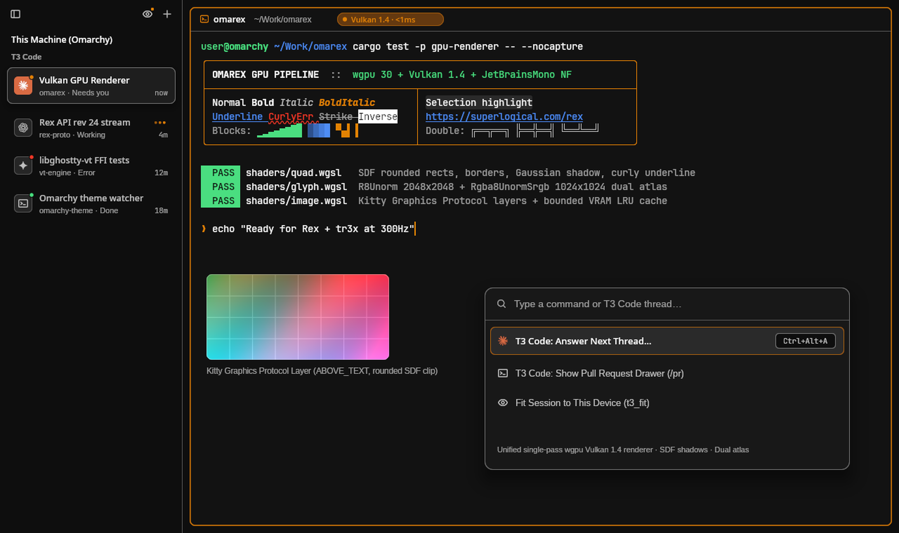

# omarex

> **Experimental Community Project (MIT Licensed)**
> `omarex` is an early, experimental native Linux desktop client for [Superlogical Rex](https://rex.superlogical.com/) on **Omarchy** (Arch Linux + Hyprland). It is built openly in Rust (`wgpu` Vulkan + `libghostty-vt`) for Linux users today — and the entire MIT codebase is wide open for the Superlogical / Rex team or any Linux contributors to inspect, borrow from, or build on top of.



Fast native Linux Wayland GUI client for [Superlogical Rex](https://rex.superlogical.com/) (API rev 24) and [`macnason/tr3x`](https://github.com/macnason/tr3x) on **Omarchy** (Arch Linux + Hyprland).

Built in **Rust** with **`wgpu` (Vulkan)** instanced GPU rendering and direct C FFI bindings to Ghostty's **`libghostty-vt`** — keeping Rex's own `libghostty` terminal engine while delivering sub-millisecond Vulkan frame times and first-class Omarchy desktop integration.

## Highlights

- **Rex API rev 24 Native Client**: Full `rex.control.v1` + `rex.data.terminal.v1` + `rex.data.bytes.v1` implementation with 1-RTT `session.bootstrap`, `reconnect_token` seamless resume, byte-counted stream recovery, bounded LRU warm-session caching, and authenticated `rex1;` APC nonce verification.
- **OSC 7577 Program Resume & Local Server Controls**:
  - Live `program_resume_records` hydration and `program_resume_changed` event tracking with trusted (`↻ <program>`) and untrusted (`⊘ <program>`) badges in pane headers.
  - Seamless active-session re-attach & stream re-open across Rex server restarts (`instance_id` change detection with stale pane/revision reset).
  - Dedicated **Settings → Server** tab (`client.server_settings`) with live version/PID/instance status, one-click Restart (resuming trusted OSC 7577 programs), two-step confirmed Stop, Start (preferring `rex-server.service`), Reload Config, and Reconnect.
  - Redacted OSC 7577 summaries in **Diagnostics HUD** and debug bundles (command argv is never logged or exported).
- **Connect Rex iOS via Tailscale QR**: Built-in **Settings → Connect iOS** tab rendering a crisp GPU-aligned ISO/IEC 18004 QR code for instant Tailscale HTTPS pairing, plus one-click Tailscale enable/login/disable actions.
- **First-Class `tr3x` / T3 Code Integration**:
  - **2-line priority tab cards** in exact server window order with provider icon tiles (Claude, OpenAI/Codex, Gemini, Copilot, OpenCode, Kimi, Hermes, T3 Code), OSC 7501 status rollup & corner attention dots (`blocked`, `error`, unseen `done`), animated working pulse / progress pie, subagent `↳` hierarchy, and relative timestamps.
  - **Native `rex.ui` modal engine** (`input` & `pick`) supporting all 16 official icons, multi-select checkboxes (`Space` toggle, `Ctrl+Enter` confirm), `allow_other` custom entries, live timeout progress bar, non-blocking unordered `client.reply`, and multi-client `client_prompt_ended` dismissal.
  - **Dual client-action & multi-server proxy support**: executes both inline `client.action.client_actions` (`rex.client.queue`) and server-pushed `client_perform_requested` (`session.select`, `pane.paste`), plus `client_call_requested` remote server forwarding.
  - **`/pr` floating drawer** (`[0.45, 0.0, 0.55, 1.0]` wide / `[0.03, 0.03, 0.94, 0.94]` narrow), draggable/resizable floating panes, minimized corner capsules, 5-zone pane drag-and-drop, and true multi-window (`GpuShared`).
- **Agent Companion 2.0 File & Media Viewer**: Interactive right-hand viewer supporting syntax-highlighted code, rich Markdown 2.0, unified Git diffs, images, audio waveforms, video, and PDFs directly from clickable terminal paths.
- **Full Modern Terminal Fidelity & Typography**:
  - HarfBuzz run-shaping font ligatures, procedural pixel-exact Powerline glyphs, 220 ms GPU Copy Shine, spring-physics pane focus borders, Vim-style Copy Mode, WCAG ANSI readability guard, and solid block-cursor glyph recoloring.
  - **Kitty Graphics Protocol** (`GHOSTTY_SYS_OPT_DECODE_PNG` -> GPU RGBA8 texture cache with bounded VRAM LRU eviction across `BelowBackground`, `BelowText`, and `AboveText` layers).
  - **Mode 5522** rich image/clipboard paste, drag-and-drop file uploads (`upload_begin`), OSC 8 clickable hyperlinks, OSC 133 prompt jumping, Mode 2026 synchronized output (`RENDER_HOLD`), and Mode 2031 (`CSI ? 997 n`) dark/light color-scheme reporting.
- **Native Omarchy & Hyprland Integration**:
  - Zero-polling **`inotify`** live theme reload from `~/.config/omarchy/current/theme/` (`colors.toml`, `alacritty.toml`, `ghostty.conf`, `light.mode`), automatically pushing `com.superlogical.terminal.set_theme` (including explicit Mode 2031 `scheme`) to owned terminal blocks.
  - Live **Hyprland IPC** sync (`$HYPRLAND_INSTANCE_SIGNATURE`) for adaptive corner rounding, gaps, and border geometry.
  - Native **D-Bus (`org.freedesktop.Notifications`)** click-to-focus notifications jumping straight to the exact `(host, session, block)` plus optional audio chimes.
- **Multi-Host Ready**: Connects simultaneously to local `unix://`, Tailscale `https://`, and `ssh://` (`rex __internal dial-stdio`) Rex servers with `hosts.list` synchronization and live listening-port pills.

## Verified Release Performance

Measured on Omarchy Linux (`x86_64`, `NVIDIA GeForce RTX 4060 Ti`, Vulkan, `1920×1080`, `libghostty-vt` SIMD + Kitty Graphics enabled):

| Benchmark | Workload | Measured Result |
| --- | --- | --- |
| **Protocol APC Framing** (`bench_proto`) | 4 MiB mixed VT + Kitty Graphics + 224 auth / 112 spoofed `rex1;` APCs | **`925.1 MiB/s`** (64 KiB chunks) / `507.9 MiB/s` (256 B chunks) |
| **Protocol View Decode** (`bench_proto`) | 23-window `T3 Code` `SessionView` (14.8 KiB) / `session_view_changed` | **`26.9 µs`** p50 / **`0.99 µs`** p50 |
| **VT Parser Throughput** (`bench_vt`) | 8 MiB dense `tr3x` ANSI + RGB + Unicode box-drawing (`180×50`) | **`607.6 MiB/s`** (`812.3 MiB/s` dense ASCII + SGR) |
| **VT Render-State Lock** (`bench_vt`) | `begin_update` mutex hold: clean / 1 dirty row / full `180×50` | **`0.06 µs`** / **`0.11 µs`** / **`2.74 µs`** p50 |
| **Snapshot First Paint** (`bench_vt`) | Streaming `GHOSTSNP` (2,001 rows, 800 KiB, `COMPRESS_HISTORY=true`) | **`0.170 ms`** p50 (`0.262 ms` p99) time-to-`READY` |
| **GPU Clean Frame** (`bench_frame`) | `180×50` pane + 23-tab sidebar (0 dirty rows, `RowId` cache hit, 6 draws) | **`0.129 ms`** p50 CPU (`0.174 ms` p99) |
| **GPU Partial Update** (`bench_frame`) | `180×50` pane + 23-tab sidebar (1 dirty row, 6 draws) | **`0.143 ms`** p50 CPU (`0.184 ms` p99) |
| **GPU Full Redraw** (`bench_frame`) | `180×50` 100% dirty + 23-tab sidebar (6 draws, 5,461 glyphs) | **`0.280 ms`** p50 CPU (`0.165 ms` GPU wait) |
| **GPU Heavy Composite** (`bench_frame`) | 4× `90×25` dirty splits + floating `/pr` drawer + Command Palette (10 draws) | **`0.545 ms`** p50 CPU (`0.741 ms` p99) |

## Keyboard Shortcuts (Omarchy / Hyprland Conflict-Free)

`omarex` leaves `Super+*` free for Hyprland window management, preserves Omarchy's universal clipboard translations (`Ctrl+Insert` / `Shift+Insert`), passes standard terminal control keys (`Ctrl+C`, `Ctrl+D`, `Shift+Enter`, etc.) untouched to the PTY, and **automatically aliases `tr3x.lua`'s macOS `ctrl+cmd+*` bindings to `Ctrl+Alt+*`** (while still matching `Super+Ctrl+*` if delivered).

### `tr3x` / T3 Code Shortcuts (Auto-Aliased from `tr3x.lua`)

| Shortcut | Rex Action | Description |
| --- | --- | --- |
| `Ctrl+Alt+I` | `t3_inbox` | Go to thread that needs you |
| `Ctrl+Alt+N` | `t3_new` | New T3 Code thread |
| `Ctrl+Alt+O` | `t3_project` | Open project picker |
| `Ctrl+Alt+A` | `t3_answer` | Answer permission / question prompt |
| `Ctrl+Alt+[` | `t3_parent` | Jump to parent thread of subagent |
| `Ctrl+Alt+]` | `t3_child` | Jump to child subagent thread |
| `Ctrl+Alt+T` | `t3_fit` | Fit panes to this device (`session.own_block` take) |

### Workspace, Palette & View

| Shortcut | Action | Description |
| --- | --- | --- |
| `Ctrl+Shift+P` | `client.palette.toggle` | Open Command Palette (built-in + `init.lua` + `tr3x` actions) |
| `Ctrl+Alt+P` | `pane.go_to` | Go to Anything (tabs, panes, sessions) |
| `Ctrl+Shift+K` | `session.switch` | Switch session across connected hosts |
| `Ctrl+Shift+N` | `session.new` | New session (`Ctrl+Alt+Shift+N` on specific host) |
| `Ctrl+Shift+B` / `Ctrl+Alt+/` | `client.sidebar.toggle` | Toggle sidebar |
| `Ctrl+Shift+S` | `client.tab_style.toggle` | Cycle toolbar layout (`left`/`right`/`top`/`bottom`) |
| `Ctrl+Shift+.` | `client.sidebar.activity.toggle` | Toggle Activity priority filter |
| `Ctrl+Alt+F` | `client.sidebar.filter.focus` | Focus sidebar tab filter |
| `Ctrl+Shift+,` | `client.settings` | Open Settings modal (Appearance, Typography, Layout, Server, Connect iOS) |
| `Ctrl+Alt+,` | `client.diagnostics` | Open Rex Diagnostics, OSC 7577 resume records & keymap warnings |
| `Ctrl+Shift+R` | `session.refresh` | Refresh sessions and views |

### Tabs & Panes

| Shortcut | Action | Description |
| --- | --- | --- |
| `Ctrl+Shift+T` | `client.tab.new` | New tab (auto-opens new `tr3x` thread inside `T3 Code`) |
| `Ctrl+Shift+W` / `Ctrl+Alt+W` | `client.close` / `client.tab.close` | Close active pane or tab |
| `Ctrl+Alt+Shift+Z` | `session.undo_close` | Undo last closed pane/tab |
| `Alt+1` .. `Alt+9` | `client.tab.goto` | Jump to tab 1–9 |
| `Ctrl+Tab` / `Ctrl+Shift+Tab` | `client.tab.next` / `previous` | Next / previous tab (also `Ctrl+PageDown` / `Ctrl+PageUp`) |
| `Ctrl+Shift+D` / `Ctrl+Shift+E` | `pane.split.right` / `down` | Split pane right / down (`Ctrl+Shift+Arrows` for all 4 directions) |
| `Ctrl+Alt+Arrows` | `pane.focus.*` | Move focus between split panes |
| `Ctrl+Alt+Shift+Arrows` | `pane.move.*` | Swap / move pane directionally |
| `Ctrl+Shift+Z` / `Ctrl+Alt+Z` | `pane.zoom` | Toggle pane zoom |
| `Ctrl+Alt+Enter` | `pane.float` | Float / dock active pane |
| `Ctrl+Alt+M` | `pane.minimize_floating` | Minimize floating pane to capsule (`Ctrl+Alt+Shift+M` all) |

### Clipboard, Search & Typography

| Shortcut | Action | Description |
| --- | --- | --- |
| `Ctrl+Shift+C` / `Ctrl+Insert` | `pane.copy` | Copy selection |
| `Ctrl+Shift+V` / `Shift+Insert` | `pane.paste` | Paste text or rich image (Mode 5522 / `upload_begin`) |
| `Ctrl+Shift+X` | `pane.copy_mode.enter` | Enter copy mode |
| `Ctrl+Shift+F` | `client.find.open` | Find in terminal scrollback (`F3` / `Shift+F3` next/prev) |
| `Ctrl+Shift+Home` / `End` | `client.prompt.previous` / `next` | Jump to previous / next OSC 133 shell prompt |
| `Ctrl+=` / `Ctrl+-` / `Ctrl+0` | `client.font.*` | Increase / decrease / reset font size |

## Requirements

- **Arch Linux / Omarchy** (`x86_64` or `aarch64`)
- System packages: `ghostty` (provides `/usr/lib/libghostty-vt.so` and `/usr/include/ghostty/vt.h`), `vulkan-icd-loader`, `wayland`, `libxkbcommon`, `fontconfig`
- Optional runtime packages: `rex` (local Rex server daemon), `tr3x` (T3 Code bridge for Rex)
- Build toolchain: Rust stable (e.g. `mise use -g rust@stable`)

## Build, Test & Install

```sh
# Build optimized release binary (target/release/omarex)
./bin/build

# Run formatting, clippy (-D warnings), and full workspace unit/integration tests
./bin/test

# Build and install Arch Linux package (binary, icon, and Omarchy app launcher .desktop entry)
./bin/install
```

Run release microbenchmarks individually:

```sh
cargo run --release -p rex-proto --example bench_proto
cargo run --release -p vt-engine --example bench_vt
cargo run --release -p gpu-renderer --example bench_frame
```

## CLI Usage

```sh
# Launch omarex connected to the default local Rex server
omarex

# Open directly to a specific session (e.g. T3 Code)
omarex "T3 Code"

# Connect to an explicit Rex endpoint (Unix socket, Tailscale HTTPS, or SSH)
omarex --server https://studio.tailnet.ts.net

# Render a live session headlessly to a PNG screenshot (CI / visual verification)
omarex --headless-render /tmp/omarex.png
```

## Architecture

`omarex` is organized as a modular Cargo workspace:

- [`crates/rex-proto`](crates/rex-proto) — Async Rex API rev 24 control/data WebSocket client, multi-host transports (`unix://`, `https://`, `ssh://`), `RexApcFramer`, and reconnect/resume state machine.
- [`crates/vt-engine`](crates/vt-engine) — Safe `libghostty-vt` C FFI bindings, streaming `GHOSTSNP` snapshot decoder, 2-phase lock-minimized `RenderState`, Kitty PNG decoding, selection/search, and input encoders.
- [`crates/gpu-renderer`](crates/gpu-renderer) — `wgpu` Vulkan/GLES instanced renderer (SDF rounded rects & Gaussian shadows, dual `etagere` glyph/icon atlas, procedural box drawing, Kitty image texture cache, `RowId` dirty-row terminal pass).
- [`crates/omarchy-theme`](crates/omarchy-theme) — Live Omarchy theme parser + `inotify` watcher, Hyprland IPC geometry sync, Mode 2031 / OSC 11 / Rex `set_theme` converters, and D-Bus desktop notifications.
- [`crates/tr3x-bridge`](crates/tr3x-bridge) — Rex `client.keymap` + Omarchy `Ctrl+Alt` auto-aliasing engine, `rex.ui` modal state machine, dual `client.action`/`client_perform_requested` dispatcher, multi-server proxy, OSC 7501 status rollup, and `rex-proto` bridge.
- [`crates/ui-chrome`](crates/ui-chrome) — Backend-agnostic `taffy` layout engine, strict `FocusTarget` guard, sidebar/tabbar/pane chrome/modals/context menus, and embedded vector icons.
- [`crates/omarex`](crates/omarex) — Final desktop binary uniting `winit` Wayland windowing, `HostManager`, `PaneStore`, `WorkspaceState`, `UserSettings`, and `OmarexController`.

See [docs/architecture.md](docs/architecture.md), [docs/protocol-spec.md](docs/protocol-spec.md), and [docs/gui-spec.md](docs/gui-spec.md) for full technical specifications.

## Open-Source Credits & Acknowledgments

`omarex` is an experimental, MIT-licensed community Linux client that stands on the shoulders of an extraordinary open-source ecosystem. Huge thanks to the Superlogical team, the Ghostty, Omarchy, Hyprland, T3 Code, and `tr3x` communities, and the maintainers of every Rust crate below.

### Ecosystem & Core Projects

| Project | Maintainers / Org | Role in `omarex` |
| --- | --- | --- |
| [Superlogical Rex](https://rex.superlogical.com/) | Mitchell Hashimoto, Jack Pearkes, Alasdair Monk, Hector Simpson & Superlogical | Rex API rev 24 protocol, multi-host architecture, and macOS UX reference |
| [Ghostty (`libghostty-vt`)](https://github.com/ghostty-org/ghostty) | Mitchell Hashimoto & Ghostty contributors | Core VT parser, terminal state machine, `GHOSTSNP` snapshots, and Kitty Graphics engine |
| [`macnason/tr3x`](https://github.com/macnason/tr3x) | `macnason` | T3 Code ↔ Rex bridge, `tr3x.lua` keymaps, `rex.ui` flows, and `/pr` drawer conventions |
| [T3 Code (`pingdotgg/t3code`)](https://github.com/pingdotgg/t3code) | Theo Browne & Ping Labs | Agentic coding workflow integrated via `tr3x` |
| [Omarchy (`basecamp/omarchy`)](https://github.com/basecamp/omarchy) ([omarchy.org](https://omarchy.org)) | David Heinemeier Hansson & Omarchy contributors | Target Arch Linux + Hyprland desktop environment and live theme system |
| [Hyprland (`hyprwm/Hyprland`)](https://github.com/hyprwm/Hyprland) | HyprWM contributors | Wayland compositor & live IPC geometry sync (rounding, gaps, borders) |

### Rust Crates

#### Graphics, Windowing, Text & UI

| Crate | Upstream | License | Usage |
| --- | --- | --- | --- |
| [`wgpu`](https://github.com/gfx-rs/wgpu) | `gfx-rs/wgpu` | `MIT OR Apache-2.0` | Vulkan / GLES instanced GPU rendering |
| [`winit`](https://github.com/rust-windowing/winit) | `rust-windowing/winit` | `Apache-2.0` | Native Wayland / X11 windowing and input event loop |
| [`cosmic-text`](https://github.com/pop-os/cosmic-text) | `pop-os/cosmic-text` | `MIT OR Apache-2.0` | Font shaping, fallback, and text layout |
| [`swash`](https://github.com/dfrg/swash) | `dfrg/swash` | `Apache-2.0 OR MIT` | Glyph and color emoji rasterization |
| [`etagere`](https://github.com/nical/etagere) | `nical/etagere` | `MIT OR Apache-2.0` | Dynamic 2D rectangle atlas packing for glyphs & icons |
| [`taffy`](https://github.com/DioxusLabs/taffy) | `DioxusLabs/taffy` | `MIT` | Backend-agnostic Flexbox/Grid UI layout engine |
| [`resvg`](https://github.com/linebender/resvg) | `linebender/resvg` | `Apache-2.0 OR MIT` | Embedded vector SVG icon rendering |
| [`tiny-skia`](https://github.com/linebender/tiny-skia) | `linebender/tiny-skia` | `BSD-3-Clause` | 2D CPU rasterizer backing SVG icon uploads |
| [`image`](https://github.com/image-rs/image) | `image-rs/image` | `MIT OR Apache-2.0` | PNG/JPEG/GIF/WebP/BMP decoding (Kitty Graphics & paste) |
| [`qrcodegen`](https://github.com/nayuki/QR-Code-generator) | `nayuki/QR-Code-generator` | `MIT` | ISO/IEC 18004 QR matrix generation for Connect Rex iOS Tailscale pairing |
| [`bytemuck`](https://github.com/Lokathor/bytemuck) | `Lokathor/bytemuck` | `Zlib OR Apache-2.0 OR MIT` | Safe zero-copy casting for GPU vertex/instance buffers |

#### Linux, Wayland & Desktop Integration

| Crate | Upstream | License | Usage |
| --- | --- | --- | --- |
| [`wayland-client`](https://github.com/smithay/wayland-rs) & [`wayland-backend`](https://github.com/smithay/wayland-rs) | `smithay/wayland-rs` | `MIT` | Direct Wayland client & surface protocol integration |
| [`zbus`](https://github.com/z-galaxy/zbus) | `z-galaxy/zbus` | `MIT` | Async D-Bus client for click-to-focus desktop notifications |
| [`notify`](https://github.com/notify-rs/notify) | `notify-rs/notify` | `CC0-1.0` | Zero-polling `inotify` watcher for live Omarchy theme reloads |
| [`arboard`](https://github.com/1Password/arboard) | `1Password/arboard` | `MIT OR Apache-2.0` | Clipboard text & rich image access (`wayland-data-control`) |
| [`rustix`](https://github.com/bytecodealliance/rustix) | `bytecodealliance/rustix` | `Apache-2.0 WITH LLVM-exception OR Apache-2.0 OR MIT` | Safe Linux syscall wrappers (`eventfd` / `pipe` wakeups) |
| [`raw-window-handle`](https://github.com/rust-windowing/raw-window-handle) | `rust-windowing/raw-window-handle` | `MIT OR Apache-2.0 OR Zlib` | Window/display handle interop between `winit`, Wayland, and `wgpu` |
| [`dirs`](https://codeberg.org/dirs/dirs-rs) | `dirs/dirs-rs` | `MIT OR Apache-2.0` | XDG configuration, cache, and data directory resolution |
| [`open`](https://github.com/Byron/open-rs) | `Byron/open-rs` | `MIT` | Opening OSC 8 hyperlinks and external URLs |

#### Networking, Async, Matching & Utilities

| Crate | Upstream | License | Usage |
| --- | --- | --- | --- |
| [`tokio`](https://github.com/tokio-rs/tokio) | `tokio-rs/tokio` | `MIT` | Async runtime, networking, SSH child process I/O, and timers |
| [`tokio-tungstenite`](https://github.com/snapview/tokio-tungstenite) | `snapview/tokio-tungstenite` | `MIT` | Async WebSocket client for Rex control and data streams |
| [`futures-util`](https://github.com/rust-lang/futures-rs) | `rust-lang/futures-rs` | `MIT OR Apache-2.0` | Async stream & sink combinators for WebSocket framing |
| [`rustls`](https://github.com/rustls/rustls) | `rustls/rustls` | `Apache-2.0 OR ISC OR MIT` | Pure-Rust TLS 1.2/1.3 for Tailscale HTTPS Rex hosts |
| [`rustls-platform-verifier`](https://github.com/rustls/rustls-platform-verifier) | `rustls/rustls-platform-verifier` | `MIT OR Apache-2.0` | Native OS certificate store verification |
| [`webpki-roots`](https://github.com/rustls/webpki-roots) | `rustls/webpki-roots` | `CDLA-Permissive-2.0` | Mozilla root CA certificates for TLS fallback |
| [`nucleo-matcher`](https://github.com/helix-editor/nucleo) | `helix-editor/nucleo` | `MPL-2.0` | Fast fuzzy matching for Command Palette, Go to Anything, and `rex.ui.pick` |
| [`serde`](https://github.com/serde-rs/serde) & [`serde_json`](https://github.com/serde-rs/json) | `serde-rs/serde`, `serde-rs/json` | `MIT OR Apache-2.0` | Rex JSON-RPC, Hyprland IPC, and state serialization |
| [`toml`](https://github.com/toml-rs/toml) | `toml-rs/toml` | `MIT OR Apache-2.0` | Parsing Omarchy theme files (`colors.toml`, `alacritty.toml`) & config |
| [`bytes`](https://github.com/tokio-rs/bytes) | `tokio-rs/bytes` | `MIT` | Zero-copy byte buffers for high-throughput APC framing & streams |
| [`uuid`](https://github.com/uuid-rs/uuid) | `uuid-rs/uuid` | `Apache-2.0 OR MIT` | UUID v4/v7 request and session identifiers |
| [`parking_lot`](https://github.com/Amanieu/parking_lot) | `Amanieu/parking_lot` | `MIT OR Apache-2.0` | Fast, compact mutexes for lock-minimized VT render state |
| [`tracing`](https://github.com/tokio-rs/tracing) & [`tracing-subscriber`](https://github.com/tokio-rs/tracing) | `tokio-rs/tracing` | `MIT` | Structured diagnostics and logging across all crates |
| [`thiserror`](https://github.com/dtolnay/thiserror) | `dtolnay/thiserror` | `MIT OR Apache-2.0` | Ergonomic typed errors across library crates |
| [`anyhow`](https://github.com/dtolnay/anyhow) | `dtolnay/anyhow` | `MIT OR Apache-2.0` | Application-level contextual error handling |

## License

MIT — see [LICENSE](LICENSE).
