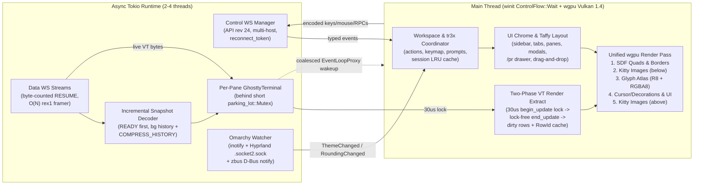
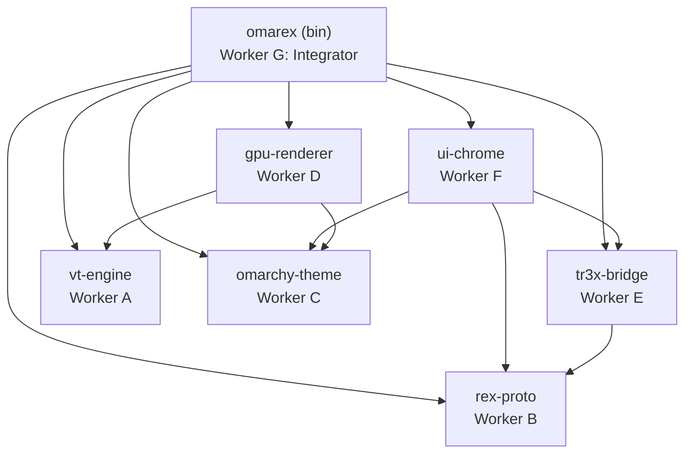

# `omarex` — Tech Stack, Performance & Architecture Specification

> Native, GPU-accelerated Linux GUI client for Superlogical's **Rex** (API rev 24) and **macnason/tr3x** on **Omarchy** (Arch Linux + Hyprland Wayland).

---

## 1. Executive Summary & Engineering Principles

`omarex` replaces the buggy, CPU-bound Qt6/QML experience of `Unayung/orex` with a **native Rust + Vulkan (`wgpu`) + `libghostty-vt`** desktop client that mirrors **Rex's own architecture**:

1. **Same VT core as Rex & Ghostty:** Direct C FFI to the system-installed `libghostty-vt.so` (`ghostty 1.4.0-1`), using its two-phase `GhosttyRenderState`, incremental dirty-row + row-identity caching, streaming `GHOSTSNP` snapshot decoder, Kitty graphics placements, and native key/mouse/selection encoders.
2. **Same client-server & Lua architecture as Rex:** Thin, blazing-fast native presentation client speaking **Rex Control API rev 24** (`session.bootstrap`, `reconnect_token`, `client.keymap`, `client.action`, `client.key`, `client.reply`, `client_prompt_requested`, `client_perform_requested`) and **Data WS `rex.data.terminal.v1`** with byte-counted stream **`RESUME`**. All Lua config (`~/.config/rex/init.lua`, `tr3x.lua`) executes server-side exactly as in Rex.app.
3. **Same GPU rendering model as Ghostty/Rex:** Instanced GPU quad + glyph-atlas + Kitty image pipeline via **`wgpu` (Vulkan 1.4)** over native **Wayland (`winit`)**, rendering both terminal grids and Rex-faithful UI chrome in a single unified GPU pass with sub-2ms frame times.
4. **Methodology from `rust-anything`, `fast-anything`, and `rea`:**
   - **From [`erkamyaman/rust-anything`](https://github.com/erkamyaman/rust-anything):** Prove behavioral correctness against recorded ground-truth fixtures (`record → port → diff → bench → gate`); batch hot loops and FFI crossings instead of per-item calls; ASCII fast paths; zero `unwrap()`/`panic!` on fallible protocol/I/O paths; minimal isolated `unsafe` blocks each backed by a `// SAFETY:` invariant; automated CI gates (`cargo fmt --check`, `cargo clippy -- -D warnings`, tests).
   - **From [`EL4CTEO/fast-anything`](https://github.com/EL4CTEO/fast-anything):** "Proof, not vibes" — measure hot paths with rotated A/A + A/B benchmarks, keep crate dependencies lean so compile times stay in seconds and `target/` stays small (avoiding multi-hundred-crate monoliths), and enforce hard latency/throughput budgets.
   - **From [`morluto/rea`](https://github.com/morluto/rea):** Ground every architectural boundary in direct binary, header, and live-wire inspection (`/usr/bin/rex` ELF symbols, `/usr/include/ghostty/vt/*.h`, live `/run/user/1000/rex/server.sock` `/llms.txt`, and `~/.config/rex/tr3x.lua`).

---

## 2. Rex's Own Tech Stack (Verified Locally & Publicly)

Direct inspection of `/usr/bin/rex` (50.5 MB Go ELF binary, `0.1.0-preview.25`, API rev 24), `/usr/bin/ghostty` (`1.4.0-1`), and Superlogical documentation confirms Rex's architecture:

| Layer | Official Rex Implementation | `omarex` Equivalent (Omarchy Linux) |
|---|---|---|
| **Server & CLI** | **Go** (`go.superlogical.com/rex/...`) + CGO bindings to **`libghostty-vt`** + embedded **Lua** engine (`~/.config/rex/init.lua`, `tr3x.lua`) | Connects unmodified to `/usr/bin/rex` (`unix:///run/user/$UID/rex/server.sock` + remote Tailscale/SSH hosts) |
| **Terminal Emulation Core** | **`libghostty-vt`** (Zig with stable C ABI): VT parser, scrollback, reflow, `GHOSTSNP` snapshots, Kitty graphics, selection, key/mouse encoders | **Exact same `/usr/lib/libghostty-vt.so`** (`ghostty 1.4.0-1`) via direct zero-overhead Rust C FFI (`crates/vt-engine`) |
| **GPU Terminal Renderer** | `libghostty` GPU renderer (Metal on macOS/iOS, DirectX on Windows, OpenGL/EGL in Ghostty Linux) using instanced cell backgrounds + dynamic glyph atlas + Kitty image layers | **Native Rust `wgpu` (Vulkan 1.4 on NVIDIA RTX 4060 Ti, GLES fallback)** with Ghostty-equivalent 4-pass instanced WGSL pipeline (`crates/gpu-renderer`) |
| **Native Window & Input** | Swift/AppKit on macOS; native client on Windows; GTK4/Wayland in Ghostty Linux | **`winit` (native Wayland)** + `libxkbcommon` physical/logical keys + Wayland IME + HiDPI fractional scaling |
| **UI Chrome & Custom UI** | Native SwiftUI/AppKit chrome + native `rex.ui.pick` / `rex.ui.input` palette & drawers | Unified **GPU UI Chrome** (`taffy` flexbox + SDF rounded rects + `cosmic-text` + `resvg` icons) rendered in the same `wgpu` pass (`crates/ui-chrome`) |
| **Scripting & `tr3x`** | Server-side Lua (`rex.action`, `rex.bind`, `rex.ui`, `rex.client.queue`) | Full **API rev 24** client contract (`client.keymap`, `client.action`, `client.key`, `client.reply`, `client_prompt_requested`, `client_perform_requested`) (`crates/tr3x-bridge`) |

---

## 3. Forensic Audit of `Unayung/orex` (Root Causes of Slowness & Bugs)

Cloning and auditing every source file of `Unayung/orex` (`~6.8k LOC` C++/Qt6/QML) pinpointed the exact root causes of every performance cliff and behavioral bug the user encountered—especially under a real workload like 23 live `T3 Code` threads synced by `tr3x` on Hyprland Wayland with a German locale.

### 3.1 Severe Performance Bottlenecks

| # | Root Cause | Exact `orex` Location | Why It Destroys Performance | How `omarex` Eliminates It |
|---|---|---|---|---|
| **P1** | **Full-pane CPU `QPainter` software rendering on every frame** | `src/terminalitem.h:13`, `src/terminalitem.cpp:1006-1117`, `src/paneborder.h:12` | `TerminalItem` and `PaneBorder` subclass `QQuickPaintedItem`, painting onto a CPU software `QImage` and uploading the **entire pane texture** to the GPU on every `update()`. Line 1029 explicitly admits: *"every row is read and the per-row dirty flags are only cleared, not used."* | Pure GPU instanced rendering via `wgpu` (Vulkan 1.4). Uses `ghostty_render_state_row_iterator_next_dirty()` + `GHOSTTY_RENDER_STATE_ROW_DATA_ID` row cache so clean rows do **zero** CPU work and **zero** texture upload. |
| **P2** | **Per-cell FFI chatter + heap allocation storm** | `src/terminalitem.cpp:378-446`, `1032-1058`, `448-509` | Every frame calls **5–7 C API functions per cell** (`RAW`, `WIDE`, `STYLE`, `GRAPHEMES_UTF8`, `FG_COLOR`, `BG_COLOR`) — **50,000+ FFI calls** for a 180×50 pane — allocates a `QString` per cell, deep-copies all 9,000 `QString`s into `d->screen` (`QList<QStringList>`), then calls `QPainter::drawText` cell-by-cell for every non-ASCII/Nerd Font/box-drawing character (shattering TUI batching in Claude Code / `tr3x`). | Uses `ghostty_render_state_row_cells_get_multi()` only on dirty rows; zero per-cell heap strings (stack UTF-8 scratch buffer → atlas lookup); packs cells into flat `#[repr(C)]` `Vec<GlyphInstance>` / `Vec<QuadInstance>` drawn in **2–3 instanced GPU draw calls total**. |
| **P3** | **Repaint storms from blink, hover regexes, selection & QML animations** | `src/terminalitem.cpp:735-752`, `819-827`, `941-951`, `1425-1434`; `src/filepaths.cpp:19-55`; `src/Main.qml:307-313, 460-465, 611-617` | Every 600ms cursor blink triggers a **full-pane 9,000-cell CPU redraw**. Every mouse pixel move runs `pathAt()` + two `QRegularExpression`s per token across wrapped lines and triggers full-pane repaints. Every `feed()` calls `selectionText()` **twice** (before and after `vt_write`) allocating full formatted selection text on every network chunk. Infinite QML pulse animations wake the scene graph at 60fps continuously. | Cursor blink mutates 1 GPU quad instance (<0.05ms, zero VT reads). Path hover is debounced by cell coordinate (only runs when `(col, row)` changes, using a zero-regex ASCII scanner). Selection invalidation checks libghostty's selection state without re-formatting text per chunk. Animations tick only via frame-paced uniform updates when visible. |
| **P4** | **Single-threaded GUI / WS / JSON / Snapshot / VT / Paint contention** | `src/main.cpp`, `src/wsclient.cpp:148-273`, `src/blockstream.cpp:90-142`, `src/terminalitem.cpp:889-939` | Everything runs on Qt's main GUI thread: WebSocket reads, byte-by-byte XOR masking, `QByteArray::remove(0, n)` `O(N)` memmoves, JSON parsing, **synchronous full `GHOSTSNP` decode including ALL scrollback pages** (`while (next() == SUCCESS)` without `COMPRESS_HISTORY`), `vt_write`, and `QPainter::paint`. | Strict thread split: async `tokio` IO/VT threads own sockets, ring-buffered framing, incremental `GHOSTSNP` decoding (`READY` renders immediately in <5ms, `next()` streams history in background with `COMPRESS_HISTORY = true`), and `vt_write`. UI thread holds a pane lock only for `ghostty_render_state_begin_update()` (~30µs). |
| **P5** | **`O(N²)` snapshot marker scanning** | `src/blockstream.cpp:103-114` | Accumulates the entire snapshot in `m_buffer` and runs `m_buffer.indexOf(m_marker)` from byte 0 on every incoming WebSocket chunk. For large scrollback snapshots (several MB), this scans gigabytes of RAM on the UI thread. | Streaming incremental state machine: feed snapshot bytes directly into `ghostty_snapshot_decoder` (`GhosttyReader` adapter) stopping at `FINISH`, then scan only newly arrived bytes (plus `marker.len() - 1` overlap) in strict `O(N)` linear time. |
| **P6** | **Startup N+1 RPC storm & QML `ListView`/`Repeater` thrashing** | `src/workspace.cpp:257-336`, `408-448`, `719-722`, `1745-1759`; `src/Main.qml:207, 573` | Fires **3 RPCs per block** (`title`, `process`, `program_status`) for every block in every session (70–140+ RPCs for 23 `T3 Code` tabs). **Each response calls `rebuildSessions()`**, rebuilding the entire `QVariantList` and causing QML `ListView` to destroy/recreate every delegate dozens of times per second. `updatePaneSlot()` replaces `m_paneSlots`, resetting QML's `Repeater` and breaking active pane drags on title updates. `session_view_changed` fetches `session.view` **twice** (`fetchSessionView` + `fetchView`). | Uses API rev 24 **`session.bootstrap`**, coalesces view/metadata updates with dirty flags per 16ms frame, deduplicates `session.view` fetches per `(host, session_id, revision)`, and uses retained indexed UI state (zero widget destruction on title/status ticks). |
| **P7** | **1-second `hyprctl` subprocess polling + `notify-send` forks + `irex-push` HTTP polling** | `src/theme.cpp:43-62`; `src/workspace.cpp:604-641`, `1266-1277` | Spawns `hyprctl -j getoption decoration:rounding` **every 1 second forever** via `QProcess`. Polls hardcoded `http://127.0.0.1:7298/mutes` even when `irex-push` isn't installed. Forks `notify-send --wait` subprocesses per notification. | Event-driven Hyprland IPC listener on `$XDG_RUNTIME_DIR/hypr/$HYPRLAND_INSTANCE_SIGNATURE/.socket2.sock` (zero polling!), `inotify` for `colors.toml` (re-arms on symlink swap), and native async D-Bus `org.freedesktop.Notifications` via `zbus`. |
| **P8** | **Session switching tears down all panes & streams** | `src/workspace.cpp:515-546` | `selectSession()` calls `closeAllPanes()`, closing every WebSocket and discarding every decoded `GhosttyTerminal` on every switch. Switching back to `T3 Code` re-downloads and re-decodes everything from scratch. | Bounded **LRU Session/Pane Stream Cache** (keeps top N recently visited sessions warm with disowned background streams or instant view state) so switching back to `T3 Code` or another active session is instantaneous. |
| **P9** | **Extra full-window FBO from `ShaderEffectSource`** | `src/Main.qml:495-499` | Always allocates a `ShaderEffectSource` pointing at `paneArea` for the zoom animation even when idle. | Animated rect interpolation directly in `gpu-renderer` with zero extra offscreen FBOs. |

### 3.2 Critical Correctness & `tr3x` Compatibility Bugs

| # | Bug | Exact `orex` Location | User-Visible Impact | `omarex` Fix |
|---|---|---|---|---|
| **B1** | **Stuck on Rex API rev 13 (ignores rev 14–24 & ALL `tr3x` contracts)** | `src/rexclient.cpp:9, 15-24, 83-96` | `orex` never fetches `client.keymap`, never sends `client.action` / `client.key`, and **silently drops `client_prompt_requested` (`rex.ui.pick`/`rex.ui.input`), `client_perform_requested` (`rex.client.queue("session.select", ...)`), `client_call_requested`, and `client.reply`**. All 25+ `tr3x` actions (`t3_inbox`, `t3_answer`, `t3_answer_next`, `t3_find`, `t3_project`, `t3_rename`, `t3_delete`, `t3_snooze`, `t3_fit`, `t3_pr`, etc.) are missing or broken. | Full **API rev 24** client: negotiates rev 24 in `hello`, fetches & live-reloads `client.keymap`, registers native actions (`session.select`, etc.), renders native modal overlays for `client_prompt_requested`, handles `client_prompt_ended`, and replies promptly via `client.reply`. |
| **B2** | **No control `reconnect_token` and zero `/api/data` `RESUME`** | `src/rexclient.cpp:15-24`; `src/blockstream.cpp:22-24`; `README.md:119-121` | Any dropped data WebSocket (`1001 keepalive timeout` or brief Tailscale hiccup) leaves a **permanently frozen/dead terminal pane** with no automatic recovery. Control reconnects create a new client ID every time. | Persists `welcome.client.reconnect_token` for seamless control resume; tracks exact consumed stream bytes per `BlockStream` and implements RFC-compliant `/api/data` **`RESUME`** (within Rex's 60s buffer window) with automatic fallback to fresh `data.connect` on `1013`. |
| **B3** | **Focus theft on every `session_view_changed`** | `src/workspace.cpp:1083-1084` | `layoutPanes()` unconditionally calls `forceActiveFocus()` on the focused terminal pane on EVERY view revision update. With `tr3x sync` continuously updating 23 threads, typing in Command Palette, Rename, or Settings gets interrupted by stolen focus! | Explicit `FocusTarget` state machine (`Terminal(BlockId)` vs `Modal(ModalId)` vs `Drawer` vs `Sidebar`): background `session_view_changed` updates NEVER steal focus from active modals/inputs/drawers. |
| **B4** | **Hardcoded US-QWERTY key map breaks German/international layouts** | `src/terminalitem.cpp:49-129` | Maps `Qt::Key_Exclam -> GHOSTTY_KEY_DIGIT_1`, etc., assuming US keyboard positions. Fails on DE QWERTZ (confirmed active on this machine!) and `AltGr` dead keys. | Uses `winit` `PhysicalKey` (evdev/USB scancode → `GhosttyKey`) + `Key` (logical/text) + `libxkbcommon` unshifted codepoint, giving 100% accurate Kitty Keyboard Protocol & international layout fidelity. |
| **B5** | **Serial 1-at-a-time input RPCs + UTF-8 corruption** | `src/blockstream.cpp:165-178` | Forces `QString::fromUtf8()` on raw input bytes and blocks subsequent input behind full RPC round-trip ACKs. Also `Main.qml:37-56` unconditionally intercepts `Ctrl+Tab`, `Alt+1..9`, `Ctrl+0/=/−` via `ApplicationShortcut` without respecting Rex key modes. | Ordered, coalesced input writer (preserving raw bytes safely as valid UTF-8/base64 per API rev 24 spec) with sub-frame local dispatch and Rex `client.keymap` + key-mode-aware shortcut routing. |
| **B6** | **Aggressive ownership hijacking & premature resize races** | `src/workspace.cpp:484-490`; `src/blockstream.cpp:58, 61-74` | Re-claims every visible pane on every window activation, clobbering multi-device ownership (`tr3x`'s `Fit to This Device` semantics). `start()` fires `data.connect` and `claim()` concurrently, racing snapshot vs resize. | Respects Rex ownership lifecycle (`request` vs explicit `take` / `Fit to This Device`), sequences `READY` snapshot decode before resize application, and uses adaptive 16–32ms resize coalescing instead of 120ms lag. |
| **B7** | **Unilateral `session.destroy` on empty view** | `src/workspace.cpp:415-417` | Automatically calls `session.destroy` if a session's windows array momentarily becomes empty during a rebuild or `tr3x` sync transition. | Never silently destroys user sessions; renders a clean Rex-style empty state with quick action to create a tab/thread. |
| **B8** | **Missing core terminal features** | `README.md:117-121`; `src/terminalitem.cpp:1262` | No Kitty Graphics rendering, no scrollbars, no smooth overscan scrolling, no terminal search (`ghostty/vt/search.h`), no rectangular selection, no keyboard pane resizing, and right-click is stolen even when TUI mouse tracking is active; file upload queues entire files into RAM without backpressure (`blockstream.cpp:254`). | First-class Kitty graphics (`GHOSTTY_RENDER_STATE_DATA_IMAGE_ITERATOR`), smooth overscan scroll + thin overlay scrollbar (`GHOSTTY_TERMINAL_DATA_SCROLLBAR`), search overlay (`search.h`), Alt+drag rectangular selection, keyboard pane resize, Shift-bypass for mouse tracking, and chunked backpressure-aware file transfers. |

---

## 4. Tech Stack Evaluation & Decision

### 4.1 Architecture Options Compared

| Criterion | **Option A (RECOMMENDED): Native Rust + `winit` + `wgpu` (Vulkan) + Custom Unified GPU UI (`taffy` + `cosmic-text`) + `libghostty-vt`** | Option B: Rust `iced` (0.14 `wgpu`) + Custom Terminal `Shader` | Option C: Rust `gpui` (Zed) + `libghostty-vt` | Option D: Rust + GTK4 + OpenGL (`GtkGLArea`) | Option E: C++/Qt6 (`orex`) |
|---|---|---|---|---|---|
| **Terminal Render Speed** | **Sub-2ms GPU instanced** (120–300Hz locked) | Sub-2ms GPU instanced (via custom `Primitive`) | Fast GPU (via GPUI text/quads) | Fast GPU (OpenGL 3.3 / GLES) | Slow CPU `QPainter` (15–50ms stalls) |
| **Input & Wayland Fidelity** | **100% raw `winit` physical/logical keys + IME + DND** (zero toolkit interception) | Medium (`iced` steals Tab/focus shortcuts; IME still maturing) | Good on Wayland, occasional NVIDIA/feature-flag friction | Good (GTK4 Wayland native) | Buggy US-only keymap, QML `ApplicationShortcut` steals keys |
| **Visual Polish (Rex macOS/Windows parity)** | **Pixel-exact** SDF rounded rects, shadows, animations, crisp HiDPI SVGs, exact Omarchy theme | Good, but Elm styling & custom animations fight modal/drawer UX | Excellent | Adwaita look; harder to match Rex macOS aesthetic cleanly | Material Design look (feels non-native to Rex) |
| **Compile Time & `target/` (`fast-anything`)** | **Fast (~25–40s clean, ~1.5s incremental; lean crate tree)** | Medium (~45–70s clean) | **Very heavy (400–600 crates, multi-min clean, 8–12 GB `target/`)**, pre-1.0 API churn | Medium (`gtk4-rs` proc macros ~45s) | Fast C++, but C++ memory/lifecycle bugs |
| **Headless Offscreen Screenshot Testing** | **First-class native `wgpu` offscreen texture → PNG!** | Hard (requires display / private internals) | Hard (no headless surface export) | Requires nested Wayland/Xvfb | Requires `QT_QPA_PLATFORM=offscreen` |
| **Parallel Swarm Maintainability** | **Ideal:** 7 clean crates with narrow trait boundaries, zero framework lock-in | Moderate (centralized Elm `Message` enum creates merge hotspots) | Poor (tight coupling to GPUI `Context<T>`/`Entity<T>` APIs) | Moderate (GLib main loop vs `tokio` friction) | Poor (`workspace.cpp` 1,886-line god class + 1,379-line `Main.qml`) |

### 4.2 Decision: **Option A — Native Rust + `winit` + `wgpu` + `taffy` + `cosmic-text` + `libghostty-vt`**

This stack hits every single user and system requirement simultaneously:
- **Exact `libghostty-vt` core** matching Rex & Ghostty byte-for-byte.
- **Native Vulkan 1.4 hardware acceleration** on the machine's NVIDIA RTX 4060 Ti 16GB (`wgpu` over `nvidia_icd.json`, with automatic OpenGL/GLES fallback if ever run without Vulkan).
- **Single unified GPU pass** for terminal grids, Kitty graphics, and Rex UI chrome — zero impedance mismatch, zero CPU software textures, zero QML/JS GC pauses.
- **Zero framework input hijacking** — full Kitty Keyboard Protocol, German/international keyboard layouts, Wayland IME, and Rex `client.keymap` / key-modes work natively.
- **Native headless offscreen rendering** directly from `wgpu` for deterministic visual regression tests in CI and swarm verification.

### 4.3 Concrete Crate Dependencies

| Layer | Crates | Rationale |
|---|---|---|
| **Windowing & Wayland** | `winit` (0.30, `wayland` + `wayland-csd-adwaita` disabled/minimal, `x11` fallback), `arboard` or `smithay-clipboard` (Wayland clipboard + primary selection) | Native Wayland surface, fractional scaling, `PhysicalKey` scancodes, IME preedit/commit, drag-and-drop file paths, `ControlFlow::Wait`. |
| **GPU Rendering** | `wgpu` (24.x / latest stable matching rustc 1.99), `bytemuck` (derive `Pod`/`Zeroable`) | Vulkan 1.4 primary backend on RTX 4060 Ti, explicit instanced pipelines, offscreen texture readback for screenshot tests. |
| **Text & Atlas** | `cosmic-text` (Fontconfig + Rustybuzz shaping + fallback), `swash` (rasterizer), `etagere` (2D shelf atlas packer), `resvg` + `tiny-skia` (SVG agent/UI icons → RGBA atlas), `image` (PNG/JPEG/WebP decoding for hover previews & test PNG export) | Crisp JetBrainsMono Nerd Font + Liberation Sans + emoji + powerline + box-drawing glyphs; cached once in GPU atlas. |
| **UI Layout & Search** | `taffy` (flexbox/grid), `nucleo-matcher` (Helix's fast fuzzy scorer) | Sub-millisecond layout calculation and instant fuzzy filtering across 100+ actions/threads/sessions. |
| **Networking & Async** | `tokio` (`rt-multi-thread`, `net`, `sync`, `time`, `macros`), `tokio-tungstenite` + `rustls` + `rustls-platform-verifier` (or `webpki-roots`), `bytes`, `serde`, `serde_json`, `uuid` | Zero-copy async WebSockets over Unix domain sockets, plain TCP, and Tailscale HTTPS TLS; strict per-host isolation. |
| **Omarchy & Linux Desktop** | `notify` (inotify), `toml`, `zbus` (D-Bus notifications + `xdg-desktop-portal` file open), `open` (or D-Bus `OpenURI`), `dirs` | Zero-polling theme & Hyprland IPC watching; native Wayland desktop notifications with interactive "Open" action. |
| **Concurrency & Telemetry** | `parking_lot` (fast uncontended mutexes for 30µs two-phase render handoff), `tracing`, `tracing-subscriber`, `thiserror`, `anyhow` | Low-overhead instrumentation for frame-budget verification and clean typed errors (no `unwrap()`). |

---

## 5. Local Omarchy System Verification & Toolchain Setup

### 5.1 Verified Target Environment (Omarchy Linux x86_64)

Checked read-only on the target machine:
- **Kernel & Desktop:** `Linux 7.2.15-1-omarchy x86_64`, Hyprland Wayland (`XDG_SESSION_TYPE=wayland`, `WAYLAND_DISPLAY=wayland-1`).
- **Display:** `DP-6` (`AOC 25G4S`, `1920x1080`, `vrr: true`, supports **60 Hz up to 300 Hz**).
- **GPUs & Drivers:** Dual **NVIDIA GeForce RTX 4060 Ti** (`AD106`, 16 GB), `nvidia-open-dkms 615.78.08-1`, `nvidia-utils 615.78.08-1`, `/usr/share/vulkan/icd.d/nvidia_icd.json`, `vulkan-icd-loader 1.4.363.0-1`, `mesa 1:26.2.5-1`, `egl-wayland 4:1.1.24-1`, `egl-wayland2 1.0.2-1`.
- **Wayland & Font Libraries (all already installed):** `wayland 1.26.0-1`, `wayland-protocols 1.49-1`, `libxkbcommon 1.13.2-1`, `fontconfig 2:2.18.3-2`, `freetype2 2.15.0-1`, `harfbuzz 14.6.0-1`. Default fonts: `JetBrainsMono Nerd Font` (monospace), `Liberation Sans` (sans-serif).
- **Terminal Core (already installed):** `ghostty 1.4.0-1`:
  - Shared library: `/usr/lib/libghostty-vt.so` → `libghostty-vt.so.0.1.0`
  - Headers: `/usr/include/ghostty/vt.h` and `/usr/include/ghostty/vt/*.h` (includes `render.h`, `snapshot.h`, `kitty_graphics.h`, `search.h`, `selection.h`, `key/encoder.h`, `mouse/encoder.h`, `paste.h`, `focus.h`, `osc.h`, `size_report.h`, `terminal.h`).
- **Live Rex & `tr3x`:** `/usr/bin/rex` (`0.1.0-preview.25`, API rev 24) listening at `unix:///run/user/1000/rex/server.sock`, live `"T3 Code"` session (`session:01a216bc-52f2-72c7-aa9a-e94e1d60b77a`) synced by `~/.local/bin/tr3x` via `~/.config/rex/tr3x.lua`.
- **Omarchy Theme Path:** `~/.local/state/omarchy/current/theme/colors.toml` (live Omarchy v4 Aether theme format: `mode`, `accent`, `selection`, `background`, `dark_background`, `darker_background`, `lighter_background`, `foreground`, `muted`, ANSI colors `red..bright_magenta`).
- **Build Tools Present:** `gcc`, `clang`, `cmake`, `ninja`, `pkg-config`, `mise`, `pacman`, `yay`, `omarchy-pkg-add`.
- **Missing Currently:** `rustc` and `cargo` are NOT yet installed on `PATH` (nor in `~/.cargo`).

### 5.2 Critical Packaging Quirk Discovered (`libghostty-vt.pc`)

> [!WARNING]
> Arch/Omarchy's `ghostty 1.4.0-1` ships `/usr/share/pkgconfig/libghostty-vt.pc` with a broken build-time staging prefix:
> ```ini
> prefix=/src/ghostty/src/ghostty-1.4.0/build/usr
> ```
> Running `pkg-config --cflags --libs libghostty-vt` emits non-existent `-I/src/ghostty/...` and `-L/src/ghostty/...` paths.

**Mandatory rule for `crates/vt-engine/build.rs`:**
1. Check `GHOSTTY_VT_LIB_DIR` / `GHOSTTY_VT_INCLUDE_DIR` env overrides first.
2. Probe `/usr/include/ghostty/vt.h` and `/usr/lib/libghostty-vt.so` directly (emitting `cargo:rustc-link-search=native=/usr/lib` and `cargo:rustc-link-lib=dylib=ghostty-vt`), falling back to `pkg-config` only if the prefix directory actually exists on disk.
3. Also verify C struct/enum layout against `/usr/include/ghostty/vt/*.h` (either via `bindgen` at build time using system `clang` OR hand-verified `#[repr(C)]` bindings cross-checked by a C layout-assertion test in `build.rs` / `cargo test`). Using `bindgen` (since `clang` is already installed!) or compile-time `sizeof`/`offsetof` assertions guarantees zero ABI drift across `ghostty` package updates!

### 5.3 Clean Rust Toolchain Setup on Omarchy (Policy-Compliant)

Two sanctioned installation paths respect Omarchy's package policy (never run `pacman -Sy` partial upgrades):

1. **Recommended for immediate dev & agent swarm (zero `sudo`, Omarchy-native via `mise`):**
   Omarchy manages user dev runtimes via `mise` (`~/.local/share/mise/installs`, confirmed `rust 1.99.1` / `1.100.0` / `stable` available in `mise ls-remote rust`):
   ```bash
   mise use -g rust@stable
   # Adds rustc, cargo, clippy, rustfmt to ~/.local/share/mise/shims (already in Omarchy PATH)
   ```
2. **System Arch package / `PKGBUILD` build environment (via `omarchy-pkg-add`):**
   `omarchy-pkg-add` safely runs `pacman -S --noconfirm --needed`:
   ```bash
   omarchy-pkg-add rust          # Arch extra/rust 1:1.99.1-1 (or rustup)
   omarchy-pkg-add vulkan-tools  # Optional: provides vulkaninfo for diagnostics
   ```

### 5.4 Fast Compile & Runtime Profile (`.cargo/config.toml` + Workspace `Cargo.toml`)

Following `fast-anything`'s compile-time discipline:
```toml
[profile.dev]
opt-level = 1              # Fast incremental compiles, snappy UI even in dev

[profile.dev.package."*"]
opt-level = 2              # wgpu, cosmic-text, swash, resvg run at full speed during dev!

[profile.release]
opt-level = 3
lto = "thin"
codegen-units = 1
strip = "symbols"
panic = "abort"
```
And for NVIDIA Wayland safety, `gpu-renderer` selects `wgpu::Backends::VULKAN` first (with `wgpu::Backends::GL` automatic fallback) and sets `PresentMode::Fifo` (VSync, tear-free on Hyprland VRR, zero busy-spin) with optional `PresentMode::Mailbox` for ultra-low-latency mode.

---

## 6. System Architecture & Data Flow

### 6.1 Threading & Pipeline Topology



### 6.2 Key Architectural Mechanics

1. **Two-Phase Lock-Free VT Rendering (`render.h:42-52`):**
   - IO thread writes incoming VT chunks into `GhosttyTerminal` under a per-pane `parking_lot::Mutex` (held only for microseconds while draining a socket read buffer), then posts a single coalesced `AppEvent::PaneDirty(BlockId)` via `winit::event_loop::EventLoopProxy`.
   - On `RedrawRequested`, the render thread locks the pane, calls `ghostty_render_state_begin_update()` + reads `GHOSTTY_TERMINAL_DATA_SCROLLBAR` and `GHOSTTY_TERMINAL_DATA_VIEWPORT_ACTIVE`, and **immediately drops the lock** (~20–50 µs).
   - `ghostty_render_state_end_update()` runs completely lock-free while IO continues unblocked.
   - If `dirty == FALSE`, row iteration is **skipped completely** (reusing cached GPU instances for that pane!).
   - If `dirty == PARTIAL` or `FULL`, only dirty rows are visited via `ghostty_render_state_row_iterator_next_dirty()`. Each row checks `GHOSTTY_RENDER_STATE_ROW_DATA_ID` against our per-pane `HashMap<RowId, CachedRowInstances>`. Unchanged rows (even scrolled rows whose ID shifted!) reuse pre-shaped glyph instances with zero shaping and zero atlas lookups.
   - `ghostty_render_state_clean()` resets dirty flags after instance upload.
   - **Synchronized Output (DEC 2026 Render Hold):** Register `GHOSTTY_TERMINAL_OPT_RENDER_HOLD`; freeze render-state updates while held with a 1,000 ms safety timeout (matching Ghostty/Rex), immediately ending hold on user scroll/selection.

2. **Streaming Incremental Snapshot Restore (`snapshot.h:188-218, 648-758`):**
   - On attaching to a block, `GHOSTTY_SNAPSHOT_DECODER_OPT_COMPRESS_HISTORY = true` is set before decode so deep scrollback never causes RAM spikes.
   - As soon as the snapshot reaches the `READY` record (active screen + continuation), `ghostty_snapshot_decoder_ready()` yields a live, immediately renderable `GhosttyTerminal` — **first paint completes in <5 ms**!
   - A background task steps `ghostty_snapshot_decoder_next()` in bounded time slices (prepending scrollback pages and Kitty image pixels safely while live VT output and rendering continue concurrently!).

3. **Zero-Stall Unified GPU Pipeline (`crates/gpu-renderer`):**
   - **Dual Glyph Atlas (`etagere::BucketedAtlasAllocator`):**
     - `R8Unorm` 2048×2048 atlas for monochrome text (crisp subpixel-positioned grayscale rasterization from `swash`, tinted in shader by per-instance RGBA foreground + gamma-corrected blending for sharp dark & light Omarchy themes!).
     - `Rgba8UnormSrgb` 1024×1024 atlas for color emoji (`Noto Color Emoji`) and pre-rasterized HiDPI SVG icons (agent logos: Claude, OpenAI/Codex, Gemini, GitHub Copilot, OpenCode, Kimi, Hermes + UI icons for `rex.ui.pick`: `document`, `folder`, `branch`, `terminal`, `code`, `server`, `database`, `package`, `globe`, `link`, `person`, `tag`, `clock`, `star`, `gear`, `plus`).
     - LRU eviction / clean atlas reset when full, uploaded via `wgpu::Queue::write_texture` only for newly rasterized glyph rects (zero full-atlas re-uploads).
   - **3 Minimal WGSL Shaders:**
     - `quad.wgsl`: Instanced SDF rounded rectangle supporting fill color, border color & width, corner radius (synced live to Hyprland `decoration:rounding`), soft drop shadow (for floating panes, modals, tooltips), and clip rect (`[min_x, min_y, max_x, max_y]`). Renders all UI chrome + terminal cell backgrounds + selection highlights + underlines/strikethroughs + cursors + progress bars + status dots.
     - `glyph.wgsl`: Instanced glyph quads sampling R8 (tinted) or RGBA8 (direct color) with clip rect.
     - `image.wgsl`: Textured image quads for Kitty Graphics Protocol (`BELOW_BACKGROUND`, `BELOW_TEXT`, `ABOVE_TEXT`, z-sorted, generation-cached textures) and file-path hover image previews.
   - **Overscan Smooth Scrolling (`render.h:97-163`):** Requests `GhosttyRenderStateOverscan { above: 1, below: 1 }` and shifts row Y coordinates by fractional pixel scroll offsets clipped to the pane scissor rect for buttery 120–300 Hz touchpad/wheel scrolling.

4. **First-Class `tr3x` & Rex API Rev 24 Contract (`crates/tr3x-bridge`):**
   - Negotiates `api_revision: 24` in `hello` (`kind: "app"`, `platform: "linux"`, `name: "omarex"`), stores `reconnect_token` (never logged!).
   - Calls `session.bootstrap` on connect (single round-trip for `attach_all` + active session attach + server status) and fetches `client.keymap` once (refreshing on `keymap_changed`).
   - Exposes native client actions (`session.select`, etc.) so `tr3x`'s `rex.client.queue("session.select", target)` immediately switches session/tab/pane on `client_perform_requested` and ACKs via `client.reply`.
   - Implements full native **`client_prompt_requested`** UI (`kind: "pick"` with single-select, `multiple`, `allow_other`, icons, subtitles, details; `kind: "input"` with initial `value`, `placeholder`, `confirm` label; countdown/auto-close on `timeout_ms` or `client_prompt_ended`) answering via `client.reply`.
   - Translates Rex's macOS-centric `ctrl+cmd+*` `tr3x` bindings cleanly to Omarchy/Linux ergonomically (supporting both `Super+Ctrl+*` where Hyprland allows and clean Linux aliases like `Ctrl+Alt+*` / palette dispatch, configurable without touching `~/.config/rex/tr3x.lua`).
   - Strict focus guard: `session_view_changed` NEVER steals focus while a modal, prompt, palette, search bar, or drawer is open.

5. **Zero-Polling Omarchy Integration (`crates/omarchy-theme`):**
   - Watches `~/.local/state/omarchy/current`, `.../theme`, and `.../theme/colors.toml` via `notify` (`inotify`), re-arming watches cleanly after atomic symlink replacements.
   - Connects directly to Hyprland's IPC event socket (`$XDG_RUNTIME_DIR/hypr/$HYPRLAND_INSTANCE_SIGNATURE/.socket2.sock`) and queries `decoration:rounding` once at startup + only on `configreloaded` events (**0 subprocesses per second** at idle!).
   - Sends Omarchy's active terminal palette to Rex via `com.superlogical.terminal.set_theme` on theme switch so programs querying OSC 10/11/4 see exact theme colors.
   - Uses `zbus` async D-Bus calls to `org.freedesktop.Notifications` with an interactive `"open"` action that focuses the exact `(host, session_id, block_id)` and activates the Wayland window.

---

## 7. Modular Workspace Layout (Zero File Collisions for Parallel Workers)

The Cargo workspace is structured as a strict acyclic dependency DAG so multiple implementation workers can build and unit-test their crates concurrently without editing overlapping files.

### 7.1 Crate Dependency Graph



*(Note: `vt-engine`, `rex-proto`, and `omarchy-theme` have **zero** internal crate dependencies and can be implemented 100% in parallel on Wave 1, alongside `gpu-renderer`'s shader/atlas scaffolding and `ui-chrome`'s layout/widget scaffolding!)*

### 7.2 Exact Directory & Ownership Map

```text
omarex/
├── Cargo.toml                            # Workspace root, pinned deps, dev/release profiles
├── .cargo/config.toml                    # Fast dev-dep builds, linker settings
├── docs/
│   ├── architecture.md                   # This document (stack-perf-architect)
│   ├── gui-spec.md                       # Visual & UX spec (video-ui-analyst)
│   └── protocol-spec.md                  # Wire & FFI contract (rex-re-engineer)
├── crates/
│   ├── vt-engine/                        # [Worker A] Direct libghostty-vt C FFI + safe Rust API
│   │   ├── Cargo.toml
│   │   ├── build.rs                      # Direct /usr/include/ghostty + /usr/lib probe (bypasses buggy .pc)
│   │   └── src/
│   │       ├── lib.rs                    # Safe Terminal, RenderState, TwoPhaseUpdate, DirtyRow, RowId
│   │       ├── ffi.rs                    # Audited extern "C" bindings + ABI layout assertions
│   │       ├── snapshot.rs               # Streaming GHOSTSNP decoder (READY + bg next() + COMPRESS_HISTORY)
│   │       ├── input.rs                  # GhosttyKeyEncoder, GhosttyMouseEncoder, Paste, Focus
│   │       ├── selection.rs              # GhosttySelectionGesture, plain-text copy, search.h
│   │       └── images.rs                 # Kitty graphics placement iterator & generation-keyed pixel reader
│   ├── rex-proto/                        # [Worker B] Rex API rev 24 Control + Data WS + Multi-Host
│   │   ├── Cargo.toml
│   │   └── src/
│   │       ├── lib.rs                    # Public RexHostClient, typed commands & event streams
│   │       ├── endpoint.rs               # unix://, https://, http://, bare Tailscale host probe
│   │       ├── transport.rs              # Async WS over UnixStream / TcpStream / rustls TLS
│   │       ├── control.rs                # API rev 24 hello/welcome, reconnect_token, bootstrap, RPC mux
│   │       ├── data_stream.rs            # Binary HELLO/WELCOME/RESUME byte counter + O(N) rex1 framer
│   │       ├── types.rs                  # Serde models matching docs/protocol-spec.md
│   │       └── transfer.rs               # Chunked upload_begin / download_begin with backpressure & cache
│   ├── omarchy-theme/                    # [Worker C] Live Omarchy Theme + Hyprland IPC + D-Bus Notify
│   │   ├── Cargo.toml
│   │   └── src/
│   │       ├── lib.rs                    # Theme palette, WCAG contrast, Rex set_theme JSON builder
│   │       ├── colors.rs                 # colors.toml parser + Omarchy dark/light defaults
│   │       ├── watcher.rs                # inotify symlink-safe watcher (debounced 50ms)
│   │       ├── hyprland.rs               # Hyprland .socket2.sock listener for live decoration:rounding
│   │       └── notify.rs                 # Async zbus org.freedesktop.Notifications ("Open" action)
│   ├── gpu-renderer/                     # [Worker D] wgpu Vulkan 1.4 Renderer + Glyph Atlas + Kitty Images
│   │   ├── Cargo.toml
│   │   └── src/
│   │       ├── lib.rs                    # GpuRenderer (Surface target + Offscreen PNG target!)
│   │       ├── context.rs                # wgpu Instance/Adapter/Device/Queue, Vulkan -> GLES fallback
│   │       ├── atlas.rs                  # R8 + RGBA8 etagere atlas, cosmic-text/swash, resvg SVG cache
│   │       ├── draw_list.rs              # Shared QuadInstance, GlyphInstance, ImageInstance, SceneFrame
│   │       ├── terminal_pass.rs          # RowId-cached incremental terminal cell -> instance builder
│   │       ├── image_pass.rs             # Kitty 3-layer z-sorted textured quads + hover previews
│   │       └── shaders/
│   │           ├── quad.wgsl             # SDF rounded rect, border, shadow, scissor/clip
│   │           ├── glyph.wgsl            # R8 monochrome tinted + RGBA8 color glyph shader
│   │           └── image.wgsl            # Textured image quad shader
│   ├── tr3x-bridge/                      # [Worker E] tr3x & Rex Lua Action/Prompt/Keymap Engine
│   │   ├── Cargo.toml
│   │   └── src/
│   │       ├── lib.rs                    # Merged ActionRegistry (built-in + server client.keymap + tr3x)
│   │       ├── prompts.rs                # client_prompt_requested state machine (pick/input) + client.reply
│   │       ├── perform.rs                # client_perform_requested (session.select, etc.) + call_requested
│   │       ├── keymap.rs                 # Keybinding resolver (Rex key modes + Linux/Omarchy chord map)
│   │       └── t3_session.rs             # T3 Code thread ordering, status badges, provider icon mapping, /pr drawer state
│   ├── ui-chrome/                        # [Worker F] Rex-Faithful GPU UI Chrome & Interactions
│   │   ├── Cargo.toml
│   │   └── src/
│   │       ├── lib.rs                    # Root UiTree -> DrawList + HitTest + FocusTarget guard
│   │       ├── layout.rs                 # Taffy layout + Rex tiled/floating split-tree pixel geometry
│   │       ├── sidebar.rs                # Collapsible host/session/tab/pane tree, status dots, mute bells
│   │       ├── tabbar.rs                 # Tab strip, urgency indicators, right-click menu
│   │       ├── pane_chrome.rs            # Pane headers, OSC 9;4 progress, dividers, floating frames, scrollbars
│   │       ├── palette.rs                # nucleo-matcher Command Palette, Session Switcher, Activity, Find Thread
│   │       ├── modal.rs                  # Native rex.ui.pick/input overlay, Rename, Add Host, Settings, Help
│   │       ├── drawer.rs                 # /pr slide-over drawer, context menus, path hover preview, toast
│   │       ├── text_input.rs             # Reusable text input (cursor, selection, clipboard, IME)
│   │       └── file_paths.rs             # Zero-regex fast file-path detector on hovered cell
│   └── omarex/                           # [Worker G] Main Binary, winit Event Loop & Runtime Wiring
│       ├── Cargo.toml
│       └── src/
│           ├── main.rs                   # CLI entry (--session, --server, --headless-render, tracing)
│           ├── app.rs                    # winit ApplicationHandler, reactive Wait loop, Wayland IME/DND/clipboard
│           ├── workspace.rs              # Multi-host Workspace state, session LRU cache, ownership controller
│           └── bridge.rs                 # Connects tokio IO/VT tasks <-> EventLoopProxy <-> UiTree <-> GpuRenderer
├── assets/
│   └── icons/                            # Embedded SVG marks (claude, openai, gemini, copilot, opencode, kimi, UI icons)
├── benches/                              # Performance benchmark gates (fast-anything / rust-anything)
│   ├── vt_throughput.rs
│   ├── frame_build.rs
│   └── protocol_parse.rs
├── tests/                                # Integration & visual screenshot suites
│   ├── live_rex_integration.rs
│   └── headless_screenshot.rs
└── pkgbuild/                             # Arch Linux & Omarchy launcher packaging
    ├── PKGBUILD
    ├── omarex.desktop
    └── omarex.svg
```

### 7.3 Strict Interface Contracts Between Crates

To allow parallel implementation before integration:
- `gpu-renderer::draw_list` defines the POD visual primitives (`QuadInstance`, `TextRun`, `ImageQuad`, `ClipRect`, `PaneRenderTarget`) consumed by `ui-chrome` and `omarex`.
- `vt-engine` exposes `Terminal::begin_render_update() -> LockedUpdate` and `RenderState::dirty_rows()` returning borrowed UTF-8/style/color spans (zero `String` allocations on the hot path).
- `rex-proto` exposes an async channel-based `HostConnection` returning strictly typed `ServerEvent` enums matching `omarex/docs/protocol-spec.md`.
- `ui-chrome` is **100% pure state → geometry/draw-list + `UiAction` outputs** — it never touches sockets, threads, or `wgpu::Device` directly, making every UI screen trivially unit-testable and snapshot-renderable!

---

## 8. Verification, Benchmarking & Performance Gate Plan

Applying `rust-anything`'s gate discipline and `fast-anything`'s measured-proof methodology, `omarex` does not ship until EVERY automated gate passes:

### 8.1 Hard Performance Targets (Measured on RTX 4060 Ti + Hyprland Wayland)

| Metric | Target Budget | Measurement Method |
|---|---|---|
| **Frame build + GPU submit (180×50 pane, partial update)** | **< 1.0 ms CPU, < 0.8 ms GPU** (120–300 Hz capable) | `benches/frame_build.rs` + runtime `tracing` frame-time histogram (p50 / p95 / p99) |
| **Full-screen redraw (4 split panes, 100% dirty)** | **< 2.5 ms CPU, < 1.5 ms GPU** (< 8.33 ms 120fps budget) | `benches/frame_build.rs` + headless `wgpu` GPU timestamp queries |
| **Cursor blink / status dot pulse frame** | **< 0.15 ms CPU** (0 VT reads, 0 cell iteration) | Runtime telemetry assertion: dirty row count == 0 |
| **Idle CPU usage (connected to 23-thread T3 Code session)** | **< 0.1% CPU**, **0 subprocess forks/min** | `pidstat` / `/proc/$PID/stat` 30-second idle measurement |
| **VT ingestion throughput (sustained burst)** | **> 150 MB/s** while keeping UI >= 60 fps | `benches/vt_throughput.rs` feeding 50 MB VT/ANSI corpus |
| **Cold startup to first painted terminal frame** | **< 80 ms** against local Unix socket | Timestamp from `main()` start to first `surface.present()` after `READY` snapshot |
| **Keystroke-to-present latency (local Rex)** | **< 1 frame (< 8.3 ms @ 120 Hz)** | Synthetic key event timestamp → `vt_write` echo → frame present |
| **RSS memory (4-pane workspace / 23-thread T3 Code)** | **< 50 MB** (4-pane) / **< 120 MB** (23-thread warm cache with `COMPRESS_HISTORY`) | `/proc/$PID/status` `VmRSS` |

### 8.2 Multi-Tier Automated Verification Suite

1. **Tier 1 — Static & Hygiene Gates (`rust-anything` gate):**
   - `cargo fmt --all -- --check`
   - `cargo clippy --workspace --all-targets -- -D warnings`
   - Audit script checking every `unsafe` block in `crates/vt-engine/src/ffi.rs` has a `// SAFETY:` comment and zero `unwrap()`/`expect()`/`panic!()` exist in `rex-proto`, `vt-engine`, `tr3x-bridge`, or `omarchy-theme` non-test code.
2. **Tier 2 — Pure Unit & Property Tests (`cargo test --workspace`):**
   - `vt-engine`: C ABI `sizeof`/enum checks, `GHOSTSNP` encode/decode round-trip (with `COMPRESS_HISTORY`), dirty-row + `RowId` invariance across scroll, key/mouse encoding (including German/non-US layouts & Kitty flags), selection extraction, Kitty graphics placement iterator.
   - `rex-proto`: Streaming `O(N)` `rex1` marker framing split across arbitrary 1-byte boundaries, byte-counted `RESUME` offset math, API rev 24 serde golden fixtures (`hello`, `welcome`, `session.bootstrap`, `client_prompt_requested`, `client_perform_requested`, `client.reply`), endpoint parser (`unix://`, `https://`, bare Tailscale).
   - `tr3x-bridge`: Action merging, `rex.ui.pick` (single, `multiple`, `allow_other`, cancel, timeout, `client_prompt_ended`), `rex.ui.input`, `session.select` perform routing, keybinding resolution.
   - `ui-chrome`: Split tree & floating layer pixel snapping, hit-testing, focus-theft prevention during active modal, zero-regex file path extraction, fuzzy ranking determinism.
   - `omarchy-theme`: `colors.toml` dark & light theme parsing, WCAG contrast calculation, atomic symlink swap detection.
3. **Tier 3 — Live Read-Only Integration Tests (`tests/live_rex_integration.rs`):**
   - Connects directly to live `unix:///run/user/1000/rex/server.sock` (API rev 24):
     - Verifies `hello` → `welcome` with `reconnect_token` and `api_revision == 24`.
     - Executes `session.bootstrap` and verifies `"T3 Code"` session + 23 windows load in **1 round-trip** (vs `orex`'s 70–140 RPCs).
     - Fetches `client.keymap` and asserts all `tr3x` actions (`t3_inbox`, `t3_answer`, `t3_find`, `t3_fit`, `t3_pr`, etc.) are discovered.
     - Opens a read-only `data.connect` stream to a live block (without stealing ownership / without modifying user sessions!), decodes `GHOSTSNP` `READY` + `next()`, drops the TCP/Unix data socket, and verifies **`RESUME`** continues cleanly from exact byte offset!
4. **Tier 4 — Headless Offscreen GPU & Live Wayland Visual Verification (`tests/headless_screenshot.rs`):**
   - Renders full scenes directly via `wgpu` offscreen texture → PNG (dark Omarchy theme, light theme, multi-pane tiled + floating layout, Command Palette, `rex.ui.pick` approval prompt, `/pr` drawer, Kitty image placement) and inspects output images visually (`read_file`) to confirm crisp glyph alignment, zero seam gaps, Hyprland corner rounding, and Rex visual parity.
   - Launches real `omarex` window on Hyprland Wayland against local `rex-server`, verifies real GPU frame presentation, and captures live desktop screenshots (`grim` / `omarchy capture screenshot`).
5. **Tier 5 — Arch Packaging & Omarchy Launcher Verification (`pkgbuild/`):**
   - `makepkg -fsi` (or `bin/install`) builds a clean Arch package installing:
     - `/usr/bin/omarex`
     - `/usr/share/applications/omarex.desktop` (`StartupWMClass=omarex`, matching `winit` Wayland `app_id = "omarex"`)
     - `/usr/share/icons/hicolor/scalable/apps/omarex.svg`
     - `/usr/share/licenses/omarex/LICENSE`
   - Verifies `omarex` appears in Omarchy's app launcher (`Super + Space`), launches cleanly, follows live Omarchy theme switches, and cleanly disowns panes on exit.
